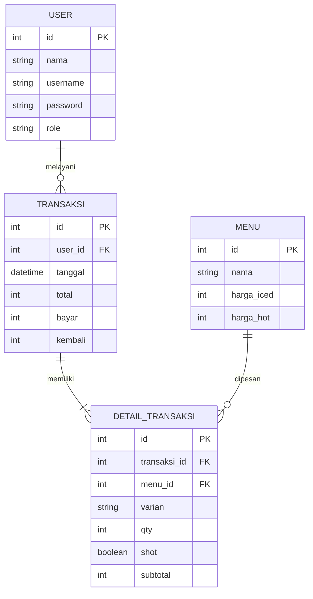

# Dokumentasi UTS - Cafe TerasA (Coffee & Tea)

## A1. Etika & Analisis Kebutuhan
**UMKM:** terasA Coffee & Tea (Instagram @coffeebyterasa), kedai kopi nyata dengan bar kecil, area duduk semi-outdoor, dan pembayaran QRIS di meja bar.
**Bukti observasi:** lihat `docs/foto/` (foto-tampak-luar, foto-bar, foto-menu, foto-minuman).
**Bukti izin (WAJIB DILENGKAPI):** tambahkan foto bersama pemilik / surat izin ke `docs/foto/izin-pemilik.jpg`.

### Alur bisnis
Pelanggan datang -> melihat menu (papan menu fisik) -> memesan ke barista/kasir -> barista mencatat pesanan -> pembayaran (tunai/QRIS) -> barista meracik -> minuman diantar -> pemilik merekap penjualan harian -> laporan.

### Masalah & harapan (sesuaikan dengan hasil wawancara Anda)
| Masalah | Harapan pemilik | Fitur solusi |
|---|---|---|
| Pencatatan manual rawan salah hitung / nota hilang | Hitung total otomatis | Halaman Kasir |
| Harga menu berubah, papan menu harus dicetak ulang | Ubah harga mudah | Kelola Menu (CRUD) |
| Sulit tahu omzet harian | Rekap otomatis | Laporan |
| Kasir tidak boleh mengubah harga | Pembatasan akses | Role-based routing |

## A2. Desain Arsitektur & Data
### Component Tree
```
App.vue
├─ layout/AppLayout.vue (navbar dinamis berdasarkan role)
│   └─ <RouterView>
│       ├─ views/KasirView.vue   -> common/BaseButton
│       ├─ views/MenuView.vue    -> common/BaseTable, BaseButton, BaseModal   [admin]
│       └─ views/LaporanView.vue -> common/BaseTable, BaseButton              [admin]
└─ views/LoginView.vue -> common/BaseButton
Pinia: auth, menu, transaksi (+ stores/persist.js)
```
### API Contract (diimplementasikan lewat Pinia + localStorage; siap dipindah ke REST)
| Method | URL | Payload / Respons |
|---|---|---|
| POST | /api/login | `{"username":"kasir","password":"kasir123"}` -> `{"id":2,"nama":"Barista Kasir","role":"kasir"}` |
| GET | /api/menu | `[{"id":5,"nama":"Aren Latte","hargaIced":15000,"hargaHot":15000}]` |
| POST | /api/menu | `{"nama":"Mocha","hargaIced":20000,"hargaHot":null}` |
| PUT | /api/menu/:id | `{"nama":"Mocha","hargaIced":22000,"hargaHot":null}` |
| DELETE | /api/menu/:id | `{"deleted":true}` |
| POST | /api/transaksi | `{"kasir":"Barista Kasir","items":[{"menuId":5,"varian":"Iced","qty":2,"shot":false}],"bayar":50000}` -> `{"id":1,"total":30000,"kembali":20000}` |
| GET | /api/transaksi | daftar transaksi + total pendapatan |
| DELETE | /api/transaksi/:id | `{"deleted":true}` |

### ERD (3NF)

### Style Guide
| Elemen | Nilai | Asal inspirasi |
|---|---|---|
| Navy `#1f2a33` | navbar, header tabel | dinding bar biru gelap |
| Wood `#c8832f` / Amber `#e0a040` | tombol utama, aksen | meja & lampu kayu hangat |
| Cream `#f6ecdc` | latar | warna susu kopi |
| Green `#4f8a76` | tombol sekunder | mural daun di kafe |
| Red `#b8483d` | hapus / error | - |
| Font | Poppins 400/600/700 | mirip logo terasA |

## A3. Implementasi
`<script setup>` di semua komponen; Vue Router dengan `beforeEach` berdasar `meta.roles`; seluruh data dari Pinia (menu, pengaturan harga shot, user, transaksi); komponen reusable: BaseButton, BaseTable, BaseModal.

## A4. Persistensi
Folder `src/seed/` berisi JSON. `stores/persist.js`: jika localStorage kosong -> ambil seed -> simpan. Perubahan disimpan otomatis dengan `watch(deep)`. Data tetap ada setelah F5 / browser ditutup.

## A5. Dokumentasi AI & Pengujian
### Log prompt (ISI SENDIRI dengan screenshot percakapan Anda)
| No | Screenshot | Prompt | Hasil |
|---|---|---|---|
| 1 | docs/ai/01.png | "Buatkan proyek Vue 3 kasir kafe terasA dari foto menu ..." | Struktur proyek, store, view |

### Skenario pengujian (isi kolom Hasil setelah menjalankan aplikasi)
| No | Skenario | Jenis | Input | Hasil diharapkan | Hasil aktual |
|---|---|---|---|---|---|
| 1 | Login benar | Benar | kasir / kasir123 | Masuk ke /kasir | |
| 2 | Login kosong | Kosong | (kosong) | "Username dan password wajib diisi" | |
| 3 | Login salah | Salah | kasir / xxx | "Username atau password salah" | |
| 4 | Kasir buka /#/menu | Akses | login kasir | Dialihkan ke /kasir | |
| 5 | Tambah pesanan Aren Latte Iced x2 | Benar | klik 2x | Total Rp 30.000 | |
| 6 | Qty 0 / minus | Batas bawah | qty = 0 | Menjadi 1 | |
| 7 | Qty 500 | Batas atas | qty = 500 | Menjadi 99 | |
| 8 | Bayar tanpa pesanan | Kosong | - | "Keranjang masih kosong" | |
| 9 | Bayar kurang | Salah | total 30000, bayar 10000 | "Uang bayar kurang dari total" | |
| 10 | Bayar pas / lebih | Benar | bayar 50000 | Kembalian Rp 20.000, tercatat di Laporan | |
| 11 | Tambah menu nama kosong | Kosong | nama "" | "Nama menu wajib diisi" | |
| 12 | Tambah menu tanpa harga | Salah | nama saja | "Isi minimal satu harga" | |
| 13 | Harga 1.000.001 | Batas atas | 1000001 | Ditolak | |
| 14 | Harga 0 | Batas bawah | 0 | Diterima | |
| 15 | Ubah & hapus menu lalu F5 | Persistensi | - | Perubahan tidak hilang | |
